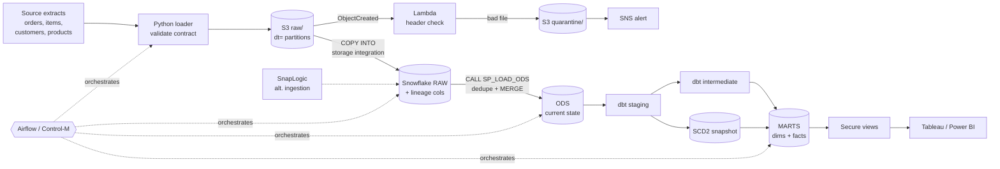

# Retail Orders ELT Platform

**AWS S3 + Lambda → Snowflake (RAW → ODS) → dbt star schema → Tableau / Power BI**
orchestrated by **Airflow** (with a **Control-M** equivalent), with a **SnapLogic** alternative ingestion path.

A compact, production-style data platform that ingests daily retail order extracts,
validates them at the door, keeps an operational data store of current state, and
builds a tested dimensional warehouse for BI, including SCD Type 2 history and
incremental loads.

---

## Architecture



**Why these layers?** RAW keeps every load exactly as received (replayable, auditable).
ODS gives operational consumers one trusted row per business key. The dbt marts are the
analytics-optimised star schema, so each layer has a single job.

---

## How this maps to the role

| JD requirement | Where it is in this repo |
|---|---|
| **Python for data engineering** | `ingestion/`: contract validation, Hive-partitioned S3 landing, Snowflake COPY, CLI with distinct exit codes; unit tests in `tests/` |
| **ELT with dbt, Snowflake, SnapLogic** | `dbt/` (sources, staging, snapshot, incremental marts, macros, 20+ tests); `snowflake/`; `snaplogic/` pipeline design |
| **Data modeling & warehousing** | ODS in `snowflake/02_tables.sql`; star schema in `dbt/models/marts/` with SCD2 `dim_customers`, `dim_products`, `dim_date`, `fct_order_lines`, `fct_daily_sales` |
| **Advanced SQL: stored procedures, functions** | `snowflake/04_procedures.sql` (transactional MERGE, QUALIFY dedup, audit logging, error handling); `snowflake/03_functions.sql` (UDFs reused by dbt) |
| **Performance optimisation** | Incremental merge with late-data lookback, `cluster_by order_date`, pre-aggregated mart, X-Small auto-suspending warehouse |
| **AWS native applications** | `aws/template.yaml` (SAM): encrypted versioned S3 with lifecycle rules, Lambda validator, SNS, CloudWatch alarm, least-privilege IAM role for Snowflake |
| **Scheduling: Airflow, Control-M** | `orchestration/airflow/dags/retail_elt_daily.py`; `orchestration/controlm/retail_elt_jobs.json` |
| **Agile ways of working** | `docs/BACKLOG.md` (user stories, acceptance criteria, DoD, WIP limit) |
| **BI & analytics** | `bi/reporting_views.sql` (secure views, REPORTER role); `bi/README.md` dashboard spec |
| **Mentoring & code review** | `docs/CONTRIBUTING.md`, `.github/pull_request_template.md`, CI in `.github/workflows/ci.yml` |

---

## Engineering decisions worth discussing

1. **Idempotency everywhere.** Batches are keyed by date; the ODS MERGE only updates when
   `updated_at` is newer, and `fct_order_lines` is an incremental MERGE. Re-running or
   backfilling any day converges to the same result.
2. **Fail fast, fail cheap.** Files are contract-checked in Python before upload *and* by
   Lambda on arrival (reading only the first 4 KB). Bad data never reaches the warehouse.
3. **Point-in-time correctness.** Customers who move generate a new SCD2 version; facts join
   to the version valid on `order_date`, so historical revenue-by-state doesn't shift.
4. **Business rules defined once.** Net amount and fiscal quarter are Snowflake UDFs that dbt
   calls through a macro, so SQL users and dbt models can never disagree.
5. **Least privilege.** Separate LOADER / TRANSFORMER / REPORTER roles; Snowflake reads S3
   through a storage integration (no keys), and BI sees only secure views.
6. **Deliberately messy test data.** The generator injects duplicate orders and customer
   relocations so the dedup and SCD2 logic are actually exercised.

---

## Quickstart

### 1. Run locally (no cloud account needed)
```bash
make setup
make test                      # unit tests
make dry-run BATCH=2026-10-28  # generate -> validate, prints row counts
```

### 2. Full deployment
```bash
make deploy-aws                                   # S3, Lambda, SNS, IAM role
# Snowflake: run snowflake/01..04 in order (paste role ARN + bucket into 01_setup.sql)
cp dbt/profiles.yml.example ~/.dbt/profiles.yml   # set SNOWFLAKE_* env vars
python -m ingestion.extract_load --batch-date 2026-10-28
make dbt-build
# Airflow: mount dbt/ at /opt/airflow/dbt, add connection `snowflake_default`, enable `retail_elt_daily`
```

### 3. Inspect results
```sql
SELECT * FROM RETAIL_DB.AUDIT.LOAD_LOG ORDER BY log_id DESC;
SELECT * FROM RETAIL_DB.MARTS.FCT_DAILY_SALES ORDER BY order_date DESC LIMIT 20;
```

---

## Repository layout
```
ingestion/        Python extract, validate, land, load (+ synthetic source generator)
aws/              SAM template + Lambda landing validator
snowflake/        DDL, RBAC, storage integration, UDFs, stored procedure
dbt/              staging -> intermediate -> marts, SCD2 snapshot, tests, macros
orchestration/    Airflow DAG, Control-M jobs-as-code
snaplogic/        SnapLogic pipeline design (alternative ingestion)
bi/               Secure reporting views + dashboard spec
docs/             Backlog, contributing / review guide
tests/            pytest unit tests
.github/          CI and PR template
```

## Next steps
Snowpipe auto-ingest, real source (REST API / CDC), anomaly tests on daily volumes,
published dbt docs site. See `docs/BACKLOG.md`.
